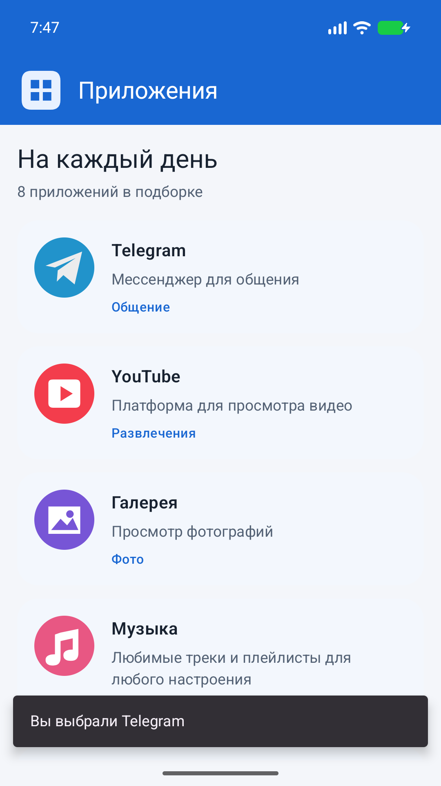
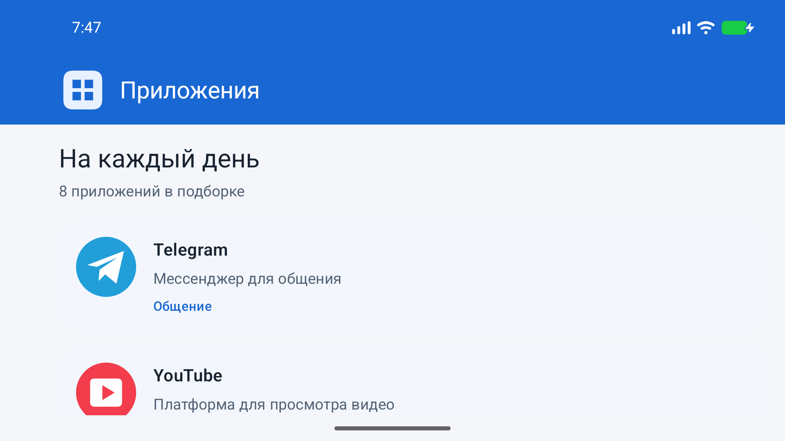

# VK Education: практическое задание 5

Список приложений из задания 4 переведён на Jetpack ViewModel. При нажатии на логотип приложения появляется Snackbar с названием выбранного приложения.

## Условие

[Урок «Архитектура Android-приложений: паттерны presentation слоя»](https://education.vk.company/curriculum/program/lesson/38881/).

Источник: презентация «Семинар 3. Архитектура Android-приложений: паттерны presentation слоя», страницы 106–107:

- Внедрить Jetpack ViewModel в список приложений.
- Добавить отображение snack при клике на логотип.
- При повороте экрана контент остаётся и не вызывается повторно.
- Snackbar не показывается повторно.

На странице 101 также рекомендованы Channel для событий и компоненты с учётом жизненного цикла. Пример преподавателя: [maltsevmicyou/VkEducation](https://github.com/maltsevmicyou/VkEducation).

## Реализация

- `data/AppsRepository.kt`: локальный источник данных, заменяемый в тестах.
- `presentation/AppListViewModel.kt`: один вызов источника при создании ViewModel; неизменяемый AppListUiState доступен через StateFlow.
- `presentation/AppListRoute.kt`: ViewModel привязана к Activity и сохраняется при изменении конфигурации. collectAsStateWithLifecycle обновляет экран, а repeatOnLifecycle(STARTED) собирает события только у активного экрана.
- Channel передаёт каждый запрос Snackbar одному получателю. Уже полученное событие не повторяется при создании нового экрана. Snackbar хранится в UI, поэтому сообщение, которое было видно перед поворотом, закрывается и не появляется заново.
- `ui/AppListScreen.kt` и `ui/components/AppItem.kt`: отображение состояния и передача нажатий в ViewModel. Логотипы имеют подписи для TalkBack и область нажатия 56 dp.

Данные локальные, интернет не нужен. ViewModel переживает поворот, но не завершение процесса Android: после нового запуска локальный список загружается заново. Часть 2 задания 4 с переходами на карточку и витрину находится в отдельной ветке и в это задание не входит.

## Сборка и проверки

Нужны Android SDK Platform 37, Android 8.0 / API 26 или новее и JDK 21 для запуска wrapper. Gradle 9.6.0 автоматически использует Java 25 согласно исходному `gradle/gradle-daemon-jvm.properties`.

```powershell
.\gradlew.bat :app:assembleDebug :app:testDebugUnitTest :app:lintDebug --console=plain
.\gradlew.bat :app:connectedDebugAndroidTest --console=plain
```

Вторая команда требует подключённого Android-устройства или запущенного эмулятора. На macOS/Linux используйте `./gradlew`.

Unit-тесты проверяют, что повторная подписка на состояние не загружает данные заново, обработанный Snackbar не повторяется у нового подписчика и событие, ожидающее активный экран, доставляется один раз. UI-тест пересоздаёт Activity, проверяет сохранение экземпляра ViewModel и состояния, отсутствие старого Snackbar и работу нового нажатия.

Ручная проверка:

1. Откройте список, нажмите на логотип Telegram и убедитесь, что появилось «Вы выбрали Telegram».
2. Пока сообщение видно, поверните устройство. Список должен остаться, а сообщение не должно повториться.
3. Нажмите на логотип снова: новое сообщение должно появиться.
4. Прокрутите список, поверните устройство обратно и проверьте сохранение позиции и отсутствие самопроизвольных сообщений.

Debug APK: `app/build/outputs/apk/debug/app-debug.apk`. Отчёты: `app/build/reports/tests/testDebugUnitTest/`, `app/build/reports/androidTests/connected/`, `app/build/reports/lint-results-debug.html`.

Ветка решения: `homework/05-viewmodel-state`, основана на `homework/04-compose-app-list`. В поле сдачи задания указывается ссылка на репозиторий с этой веткой.

## Результат проверки

- Сборка debug APK и test APK: успешно.
- Unit-тесты: 3 проверки ViewModel и базовый тест проекта, без ошибок.
- Android Lint: без ошибок; сохранены исходные предупреждения о неиспользуемых ресурсах и доступных обновлениях библиотек.
- Инструментальные тесты на Android 17 / API 37: 2 теста, без ошибок, включая пересоздание Activity и отсутствие повторного Snackbar.
- Отдельно проверен поворот эмулятора из портрета в альбомную ориентацию во время показа сообщения: список сохранился, старое сообщение не появилось снова.

| Нажатие на логотип | После поворота |
| --- | --- |
|  |  |
